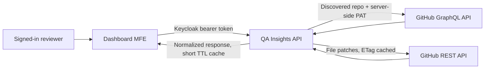

# GitHub PR data: current coverage and next options

The GitHub integration keeps the fine-grained, read-only credential on the QA
Insights API. The dashboard calls that API with the existing Keycloak access
token; it never receives the GitHub PAT. Repository discovery shows every
repository visible to the shared API token to every signed-in dashboard user.

## What the UI can show today

| Area | Data available | Current fetch size / bound |
| --- | --- | --- |
| PR list | Title, author, draft/state, branches, labels, review decision, additions/deletions, changed-file count, CI rollup state, update time | 20 per request by default; API permits up to 100. Cursor-based (`after` / `endCursor`) with a 45-second in-memory cache. |
| PR detail | Description, author, base/head branch and SHA, labels, mergeability, state, merged flag, review decision and requested reviewers | One GraphQL query, cached for 45 seconds. |
| Reviews | Review author, state, timestamp, body | Up to 50 reviews in the detail query. |
| Review threads | File/line, resolved/outdated state, comments | Up to 50 threads and 20 comments per thread in the detail query. |
| Conversation | PR conversation comments | Up to 50 comments in the detail query. |
| Changed files | Name, status, additions, deletions, and patch where GitHub provides one | Up to 100 per GraphQL page, cursor-paged to a maximum of 3,000 files; REST patches use `per_page=100`, follow `Link`, and send `If-None-Match` when an ETag is cached. Binary/oversized files may not have a patch. |
| CI summary | Combined status-rollup state and check/status-context name, state, conclusion, and URL | Up to 50 check contexts from the latest PR commit. |

These are request sizes and implementation bounds, not a promise that every
GitHub object has that many records. GitHub may omit patch text for binary or
large files, and some values can be null or `UNKNOWN`.

## Additional data that could be added

| Candidate | What the UI could show | Likely API/source | Notes |
| --- | --- | --- | --- |
| Full commit history | Commit list, author, message, timestamp, check state; optionally file-level commit changes | GraphQL `PullRequest.commits` connection | Cursor-paginate. The current integration only requests the latest commit for the CI rollup. |
| CI job details | Workflow name, run number, trigger, branch/SHA, duration, attempt, conclusion, per-job status | REST Actions workflow runs and jobs endpoints | Workflow-runs listing supports `per_page` up to 100; GitHub documents a 1,000-result search cap for certain filters. Requires Actions read access for private repos. |
| CI logs and artifacts | Expandable job logs and downloadable artifact metadata | REST Actions jobs/logs/artifacts endpoints | Fetch only on demand; logs/artifacts can be large or expire. Treat signed log/artifact URLs as sensitive and short-lived. |
| Deployment status | Environment, deployment URL, actor, start/completion time, success/failure | Deployments and deployment-status APIs, or GraphQL deployments | Useful after checks pass; requires the corresponding read permissions and repo data availability. |
| Rich checks | Annotations, check-suite links, started/completed times, rerun attempts | REST check runs and check suites | The current response includes the latest rollup and its first 50 contexts, not full annotations/history. |
| More review context | Review-comment diff positions, reactions, dismissal state, requested reviewers beyond the first page | GraphQL review/review-thread connections and REST review comments | Paginate connections; load long histories on demand. |
| PR timeline | Commits, assignments, labels, milestones, state changes, force pushes, and review events in chronological order | REST issue timeline/events endpoints | Pull requests are also issues; issue-style activity is exposed via issue endpoints. |
| Repository overview | Default branch, language mix, open issue/PR counts, releases, recent activity | GraphQL repository fields and releases APIs | Could power the dashboard landing card before a repository is selected. |

### Suggested implementation order

1. **Commit history** — most directly useful during review; paginate on the detail page and load as a separate section.
2. **Per-workflow and per-job status** — make the existing CI summary actionable; filter runs to the PR head SHA and fetch jobs only when a run is opened.
3. **Annotations and logs** — fetch lazily after a reviewer selects a failing check to avoid oversized responses and unnecessary API calls.
4. **Timeline and deployments** — add after the basic review/CI path is useful and access permissions are agreed.

Each addition should validate repositories against token-backed discovery, use
bounded cursor or REST pagination, normalize upstream errors, and avoid
returning large logs or artifacts in the initial PR-detail response. The
existing 45-second response cache can be kept for summaries; high-volume
history should be loaded on demand and cached separately.

## GitHub references

- [REST pull request endpoints](https://docs.github.com/en/rest/pulls/pulls)
- [List pull request files](https://docs.github.com/en/rest/pulls/pulls#list-pull-requests-files)
- [List commits on a pull request](https://docs.github.com/en/rest/pulls/pulls#list-commits-on-a-pull-request)
- [REST Actions workflow runs](https://docs.github.com/en/rest/actions/workflow-runs)
- [REST Actions workflow jobs](https://docs.github.com/en/rest/actions/workflow-jobs)
- [REST check runs](https://docs.github.com/en/rest/checks/runs)
- [GraphQL pull request fields and connections](https://docs.github.com/en/graphql/reference/objects#pullrequest)
